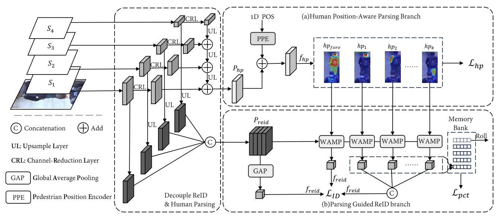

<div align="center">

# DROP · IEEE TBIOM 2026

### Decouple Re-Identification and Human Parsing<br>for Occluded Person Re-Identification

Shuguang Dou, Yuanpeng Tu, Yanna Lin, Junyao Gao, Cairong Zhao

**IEEE Transactions on Biometrics, Behavior, and Identity Science**<br>
Volume 8, Issue 4, Pages 666–677, 2026

[**Paper**](https://doi.org/10.1109/TBIOM.2026.3680760) · [**Installation**](#installation) · [**Reproducing the results**](#reproducing-the-results) · [**Citation**](#citation)

</div>

## Overview

DROP addresses occluded person re-identification by decoupling the feature paths for identity representation and human parsing. A shared HRNet-W32 backbone supplies multi-scale features: the ReID path learns appearance representations, while an FPN parsing path predicts semantic part masks with height-position information. The predicted masks guide foreground/part pooling and visibility-aware matching.

<p align="center">
  
  <br>
  <em>DROP framework. Original Fig. 2 from the <a href="https://arxiv.org/html/2401.18032v1#S3.F2">author preprint (arXiv:2401.18032v1)</a>.</em>
</p>

This repository contains the paper's HRNet + FPN model, training and evaluation code, and configurations for six person ReID datasets.

## Installation

Use **Python 3.10–3.12** in an isolated environment. Run the following commands from a terminal:

```bash
git clone https://github.com/shuguang-52/2026-TBIOM-DROP.git
cd 2026-TBIOM-DROP
python -m venv .venv
# Linux/macOS: source .venv/bin/activate
# Windows PowerShell: .venv/Scripts/Activate.ps1
```

Install PyTorch and torchvision for your machine. For example, the CUDA 12.1 wheels for Linux/Windows:

```bash
python -m pip install torch==2.5.1 torchvision==0.20.1 --index-url https://download.pytorch.org/whl/cu121
python -m pip install -r requirements.txt
python -m pip install -e .
```

See the [official PyTorch 2.5.1 installation options](https://pytorch.org/get-started/previous-versions/#v251) for other CUDA builds. For CPU smoke tests, replace `cu121` with `cpu`. Use the dependency versions and bounds in [requirements.txt](requirements.txt).

## Reproducing the results

### 1. Prepare datasets and parsing labels

Download the datasets and the [BPBreID human-parsing labels](https://github.com/VlSomers/bpbreid#download-human-parsing-labels) separately. Dataset images, parsing labels, and trained DROP checkpoints are not included in this repository.

Set `--root` to the parent directory containing the dataset folders expected by the [dataset loaders](torchreid/data/datasets/image). Follow the BPBreID layouts, including the train/query/gallery splits, and place the parsing labels in each dataset's `masks/pifpaf_maskrcnn_filtering/` directory. For example:

```text
reid-data/
└── Market-1501-v15.09.15/
    ├── bounding_box_train/
    ├── bounding_box_test/
    ├── query/
    └── masks/
        └── pifpaf_maskrcnn_filtering/
            ├── bounding_box_train/
            ├── bounding_box_test/
            └── query/
```

Occluded-ReID expects the reorganized `train/`, `query/`, and `test/` folders containing `.tif` images. MSMT17 also needs its `list_train.txt`, `list_val.txt`, `list_query.txt`, and `list_gallery.txt` files.

Keep the training split available when evaluating: the entry point also uses it to construct the model's identity classifiers. MSMT17 requires the **V1** layout and its corresponding masks.

### 2. Download the pretrained backbone

Download the ImageNet-pretrained **HRNet-W32** weights from [HRNet Image Classification](https://github.com/HRNet/HRNet-Image-Classification) and place the file at:

```text
pretrained_models/hrnetv2_w32_imagenet_pretrained.pth
```

To use another location, append `model.bpbreid.hrnet_pretrained_path /path/to/pretrained_models` to the training command. This setting takes the **containing directory**. These ImageNet weights initialize the backbone; evaluation requires a trained DROP checkpoint.

### 3. Train DROP

Run all commands from the repository root. To train on Occluded-Duke:

```bash
python -m scripts_reid.main --config-file configs/drop/drop_occ_duke_train.yaml --root /path/to/reid-data
```

To train on Market1501:

```bash
python -m scripts_reid.main --config-file configs/drop/drop_market1501_train.yaml --root /path/to/reid-data
```

Choose the configuration matching your dataset:

| Dataset | Folder under `--root` | Input (H × W) | Train | Test |
| :--- | :--- | :---: | :---: | :---: |
| Occluded-Duke | `Occluded_Duke` | 256 × 128 | [Train](configs/drop/drop_occ_duke_train.yaml) | [Test](configs/drop/drop_occ_duke_test.yaml) |
| Occluded-ReID | `Occluded_REID` | 384 × 128 | [Train](configs/drop/drop_occ_reid_train.yaml) | [Test](configs/drop/drop_occ_reid_test.yaml) |
| P-DukeMTMC | `P-DukeMTMC-reid` | 384 × 128 | [Train](configs/drop/drop_p_dukemtmc_train.yaml) | [Test](configs/drop/drop_p_dukemtmc_test.yaml) |
| Market1501 | `Market-1501-v15.09.15` | 384 × 128 | [Train](configs/drop/drop_market1501_train.yaml) | [Test](configs/drop/drop_market1501_test.yaml) |
| DukeMTMC-ReID | `DukeMTMC-reID` | 384 × 128 | [Train](configs/drop/drop_dukemtmc_train.yaml) | [Test](configs/drop/drop_dukemtmc_test.yaml) |
| MSMT17 | `MSMT17_V1` | 256 × 128 | [Train](configs/drop/drop_msmt_train.yaml) | [Use evaluation override below](#4-evaluate-a-checkpoint) |

Outputs are saved under `logs/<job_id>/`, including `config.yaml`, `logtxt/train_log.txt`, and model checkpoint subfolders. Use `--save_dir /path/to/outputs` to change the output root. Training and evaluation details are written to the text log.

The configurations also specify part grouping, batch sizes, and loss weights. Append overrides to adapt a run to your hardware, for example `data.workers 4 train.batch_size 32`. On Linux, prefix a command with `CUDA_VISIBLE_DEVICES=0` to select a GPU.

### 4. Evaluate a checkpoint

Pass a trained DROP checkpoint with the matching dataset configuration:

```bash
python -m scripts_reid.main --config-file configs/drop/drop_occ_duke_test.yaml --root /path/to/reid-data model.load_weights /path/to/drop_checkpoint.pth.tar
```

MSMT17 uses its training configuration with evaluation overrides:

```bash
python -m scripts_reid.main --config-file configs/drop/drop_msmt_train.yaml --root /path/to/reid-data test.evaluate True model.load_weights /path/to/drop_checkpoint.pth.tar model.pretrained False
```

Use the same architecture, part grouping, and image dimensions as the checkpoint. Evaluation uses predicted part masks by default; external parsing labels supervise training. A trained checkpoint is required to report ReID accuracy.

<details>
<summary><strong>Code structure and development checks</strong></summary>

| Path | Purpose |
| :--- | :--- |
| [torchreid/models/bpbreid.py](torchreid/models/bpbreid.py) | DROP parsing head, part masks, and identity representations |
| [torchreid/models/hrnet.py](torchreid/models/hrnet.py) | HRNet backbone and FPN feature path |
| [torchreid/engine/image/part_based_engine.py](torchreid/engine/image/part_based_engine.py) | Training and visibility-aware evaluation |
| [torchreid/losses/](torchreid/losses) | Identity, triplet, and parsing objectives |
| [scripts_reid/](scripts_reid) · [configs/drop/](configs/drop) | Entry point and dataset configurations |

Run the lightweight checks without downloading datasets or model weights:

```bash
python -m unittest discover -s tests -v
python -m scripts_reid.main --help
```

Logs and visualizations are saved locally by default. Optional experiment trackers are listed in [requirements-logging.txt](requirements-logging.txt) and must be enabled explicitly. The default evaluator uses Python/NumPy; compiling the retained Cython source is optional.

This curated release includes runtime compatibility fixes. These checks validate code execution; reproducing the published accuracy requires the corresponding datasets, training settings, and trained weights.

</details>

## Citation

If you find this code useful, please cite our paper published in **IEEE TBIOM**:

```bibtex
@article{dou2026decouple,
  title={Decouple Re-Identification and Human Parsing for Occluded Person Re-Identification},
  author={Dou, Shuguang and Tu, Yuanpeng and Lin, Yanna and Gao, Junyao and Zhao, Cairong},
  journal={IEEE Transactions on Biometrics, Behavior, and Identity Science},
  year={2026},
  volume={8},
  number={4},
  pages={666--677},
  doi={10.1109/TBIOM.2026.3680760},
  url={https://doi.org/10.1109/TBIOM.2026.3680760}
}
```

## Acknowledgments

Our implementation builds on [BPBreID](https://github.com/VlSomers/bpbreid), [Torchreid](https://github.com/KaiyangZhou/deep-person-reid), and [HRNet](https://github.com/HRNet/HRNet-Image-Classification). We thank their authors for sharing their code. Please also cite their work when applicable.

See [LICENSE](LICENSE) and [THIRD_PARTY_NOTICES.md](THIRD_PARTY_NOTICES.md) for retained upstream terms and attribution.
